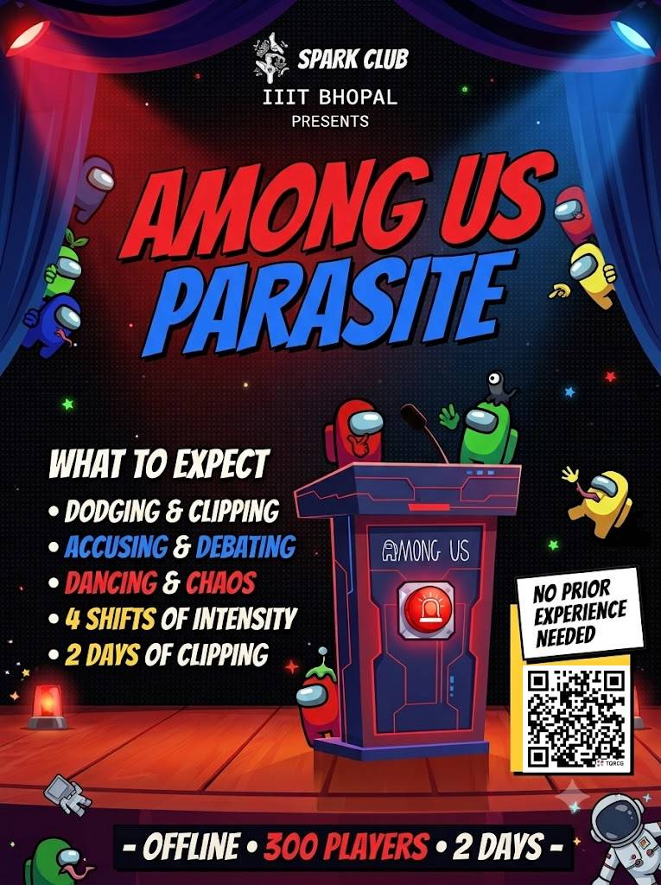

**EMERGENCY\
MEETING**

**BLACKOUT!**

Close your eyes. Cover your ears.

[SPARK CLUB](#home)

[The Weapon](#weapon)[Small Tasks](#tasks)[Day 1 · Qualifiers](#day1)[Day 2 · Finale](#day2)[Register →](#register)

Spark Club · IIIT Bhopal · Live event

AMONG USPARASITE

[Enter the ship](#weapon)

The event

## Offline. Loud. Chaotic.

Among Us: Parasite takes the game off the screen and into a packed hall at IIIT Bhopal. 300 players, 4 shifts and 2 days of clipping, dodging, dancing and accusing. Dates and venue details are shared in the WhatsApp group after you register.

**OFFLINE****300 PLAYERS****2 DAYS**

NO PRIOR EXPERIENCE NEEDED

The core mechanic

## The clothespin kill.

Forget cards and apps. In Among Us: Parasite, imposters carry a physical weapon, and it is a neon clothespin. 300 players, 4 shifts, 2 days and one very suspicious pocket.

### How a kill works

1. Each Imposter is secretly given a pocket full of neon clothespins. These are the Parasites.
2. To eliminate a Crewmate, clip a Parasite onto their shirt, jacket or backpack without them noticing.
3. If the Crewmate feels the clip and turns around, the Imposter must pretend nothing happened. Pure physical comedy.

**Safety rule:** clips go on clothing or bags only, never skin or hair. No grabbing, no chasing.

Small tasks

## Between the chaos, do your tasks.

Every Crewmate gets a Task Card. Task stations are set up around the hall, staffed by volunteers. Finish a 30-second task, get a stamp. Imposters get a fake card and have to look busy doing decoy tasks. Each station fits 3 players at a time.

\~20 sec

### Fix Wiring

Connect four matching color cords on the board before the volunteer finishes counting.

\~15 sec

### Swipe Card

Slide a card through the cardboard reader. Too fast or too slow and it says "bad swipe".

\~15 sec

### Upload Data

Stand on one leg while the volunteer's progress bar fills. Wobble and the upload restarts.

\~30 sec

### Fuel Engines

Carry a ping-pong ball on a spoon across the course and drop it in the fuel can.

\~20 sec

### Calibrate

Watch a 5-color light sequence, then repeat it exactly from memory.

\~15 sec

### Empty Trash

Land 3 paper balls in the bin from behind the line.

**SHIELD**Collect 4 stamps to earn a Shield: it cancels one clothespin at a Body Scan, once. Stamps also break ties for the Golden Ticket.

Day 1

## The qualifiers.

**4 SHIFTS****75 PLAYERS EACH****15-MIN ROUNDS**

1

### Megaphone Chaos

The organizer is a hype-man with a megaphone and a DJ speaker. Every 2 minutes the music stops and a chaotic task is screamed at the room.

Everyone do the Macarena with a stranger!Form a train of 4 and choo-choo across the room!Everybody freeze like a statue!

These chaos tasks keep the room loud and moving, so the two minutes between them never turn into a talking circle. And while everyone is distracted, the Imposters are busy clipping backs.

2

### The Body Scan

Nobody knows who is dead yet. Every 4 minutes a siren plays and the hype-man yells **BODY SCAN!**

Everyone stops and checks themselves and their friends for neon clothespins. Found a pin on you? You are dead. Die theatrically and leave the floor. Best dramatic death wins a candy prize.

3

### The Public Tribunal

Catch an Imposter mid-clip and yell **CAUGHT!** The accuser and accused go to center stage. The accused gets a microphone and exactly 15 seconds to defend themselves.

The crowd votes: thumbs up for innocent, thumbs down to eject. Ejected players get hit with a giant squeaky inflatable hammer and they are out.

Megaphone every 2 minBody scan every 4 min

**GOLDEN TICKET**Survive the 15-minute shift and you earn a Golden Ticket to the Day 2 finale.

Day 2

## The grand finale: the mutation.

All Day 1 survivors return. These are the best and most paranoid players, so the rules get meaner.

1

### Zombie Ghosts

Dead players no longer leave. They become Zombies, holding hands in pairs and walking the room as living walls. They cannot clip anyone, but they block paths and cause traffic jams that help the Imposters.

2

### The Blackout

Once during the finale the music cuts and the hype-man yells **BLACKOUT!** Every Crewmate closes their eyes and covers their ears for 20 seconds.

Only Imposters keep their eyes open. They have 20 seconds to clip as many people as possible.

3

### The Ultimate Winner

The finale runs on a 25-minute timer. Catch every Imposter through Public Tribunals before it ends and the surviving Crewmates split the grand prize.

If even one Imposter is still standing at the buzzer, the Imposters steal the glory and the prize.

## Think you can spot the parasite?

Seats are limited to 300 players.

Registration open

## Join the crew.

Fill in the form to claim a seat. You will get a registration number. Save it. The Spark team uses your email and WhatsApp number for updates.

**Remember:** no experience needed. Just a poker face and a quick pair of hands.

Name Roll no. Program Year WhatsApp number Email ID

✓ Registration complete

## You're in.

REGISTRATION NUMBER

**Important:** joining the WhatsApp group is mandatory for all registered players. All updates, rules and announcements are shared there.\
[JOIN WHATSAPP GROUP](https://chat.whatsapp.com/)

THE SPARK\
CONTINUES...

Spark Club, IIIT Bhopal · Fan event, not affiliated with Innersloth

[IG](https://www.instagram.com/spark_iiitb/)[in](https://www.linkedin.com/)[WA](https://chat.whatsapp.com/)